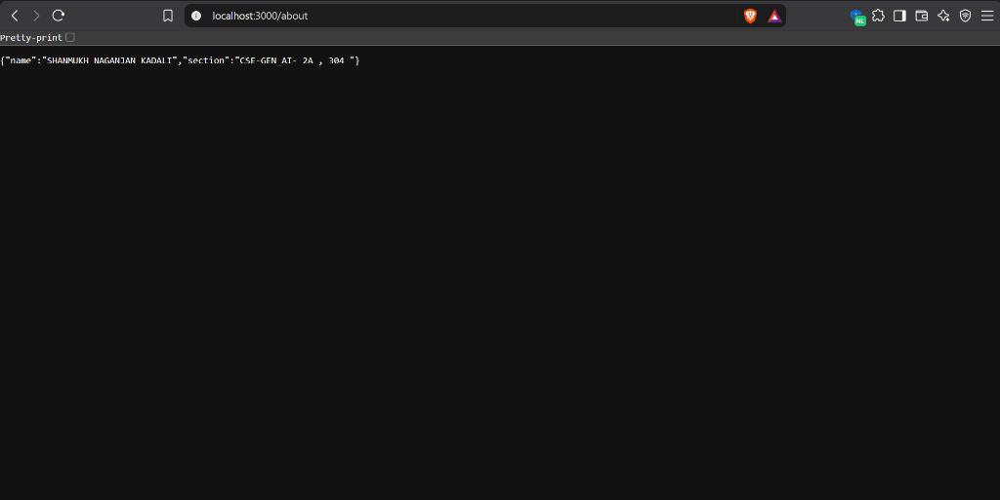
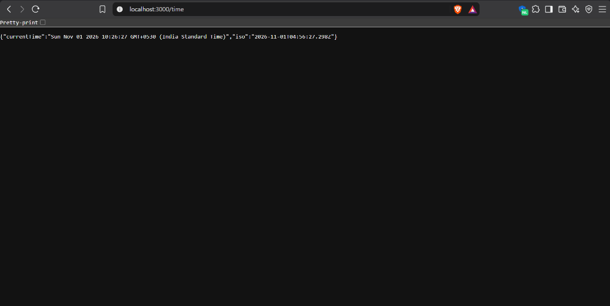
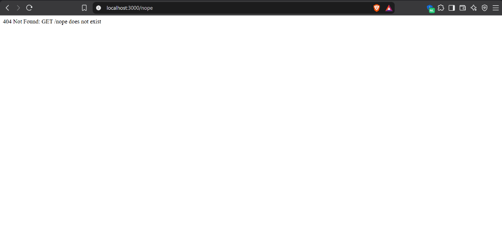

# Lab Report 1: Node.js and Express Server

**Name:** SHANMUKH NAGANJAN KADALI · **Registration number:** 252U1R9050 · **Section:** CSE GEN_AI-2A , 304  
**GitHub repository:** [https://github.com/shanmukh-JS/BACKEND_LAB_REPORTS](https://github.com/shanmukh-JS/BACKEND_LAB_REPORTS)  
**Live link:** <YOUR RENDER URL, or "Not deployed" with the reason>

---

## 1. Objective
The primary objective of this laboratory work is to understand the core architecture of Node.js and Express.js for backend web development. Specifically:
- Initializing and structuring a Node.js project using npm.
- Comparing low-level HTTP servers built using Node's native `http` module against higher-level web frameworks like Express.
- Implementing custom REST routing (`/`, `/about`, `/time`) and configuring fallback 404 handlers.
- Understanding dependency management, manifest configuration (`package.json`), and version control hygiene (`.gitignore`).

---

## 2. Introduction
Node.js is an open-source, cross-platform JavaScript runtime built on Chrome's V8 engine that allows JavaScript to be executed server-side using an event-driven, non-blocking I/O model. Express.js is a minimal and flexible Node.js web application framework providing a robust set of features for routing, middleware handling, and HTTP request/response lifecycles. This lab covers foundational client-server communication from raw HTTP primitives to structured Express applications.

---

## 3. Technologies Used
- **Runtime Environment:** Node.js (v18+)
- **Package Manager:** npm (Node Package Manager)
- **Web Framework:** Express.js (v5.x)
- **Language:** JavaScript (CommonJS)
- **Testing & Verification:** Web Browser, cURL, Git

---

## 4. Project Structure

```text
Lab Report 1/
├── screenshots/
│   ├── home.png            # Screenshot of GET / (Welcome text)
│   ├── about.png           # Screenshot of GET /about (JSON with name & section)
│   ├── time.png            # Screenshot of GET /time (JSON with date & ISO timestamp)
│   └── 404.png             # Screenshot of 404 Not Found route
├── node_modules/           # Ignored by Git (contains Express and dependencies)
├── .gitignore              # Ignores node_modules/ and .env
├── package.json            # Project manifest, scripts, and dependencies
├── package-lock.json       # Exact dependency tree lockfile
├── plain-server.js         # Native Node.js http.createServer implementation
├── server.js               # Express application with routes and 404 handling
├── status-log.txt          # Recorded test logs with HTTP status codes
└── README.md               # Laboratory report and documentation
```

---

## 5. Implementation Details

### Task 1 & 2: Project Initialization & Dependency Management
The project was initialized using `npm init -y` to generate a standard `package.json` manifest. Express was installed via `npm install express`, which downloaded the framework and its transitive dependencies into the `node_modules/` folder while locking exact versions in `package-lock.json`.

### Task 3: Plain HTTP Server (`plain-server.js`)
Implemented a foundational HTTP web server using Node's core `http` module:
- Creates a server with `http.createServer((req, res) => { ... })`.
- Sets response headers with `res.writeHead(200, { 'Content-Type': 'text/plain' })`.
- Returns the string `"Hello"` and listens on port `3000`.

### Task 4 & 5: Express Application & Routing (`server.js`)
Constructed an Express web application listening dynamically on `process.env.PORT || 3000`:
- **GET `/`**: Sends a welcome text message (`200 OK`).
- **GET `/about`**: Returns a JSON object containing student identity details:
  ```json
  {"name": "SHANMUKH NAGANJAN KADALI", "section": "CSE-GEN_AI- 2A , 304 "}
  ```
- **GET `/time`**: Generates and returns dynamic timestamps using JavaScript's native `Date` object:
  ```json
  {"currentTime": "<Local Time>", "iso": "<ISO 8601 Timestamp>"}
  ```

### Task 6: Catch-All 404 Middleware
Configured a terminal middleware at the bottom of the routing stack to catch any undefined routes:
```javascript
app.use((req, res) => {
  res.status(404).send(`404 Not Found: ${req.method} ${req.originalUrl} does not exist`);
});
```

---

## 6. How to Run

```bash
# 1. Navigate to the project directory
cd "Lab Report 1"

# 2. Install dependencies
npm install

# 3. Start the Express server (Runs on http://localhost:3000)
npm start

# 4. Alternatively, run the plain HTTP server
npm run plain
```

*Environment variables:* `PORT` (optional, defaults to 3000). No `.env` file is required for this lab.

---

## 7. Endpoints & Route Specifications

| Method | Path | Description | Response Type | Expected Status |
| :--- | :--- | :--- | :--- | :--- |
| **GET** | `/` | Welcome banner text | `text/html` / `text/plain` | `200 OK` |
| **GET** | `/about` | JSON containing student name and section | `application/json` | `200 OK` |
| **GET** | `/time` | Current local and ISO-8601 timestamps | `application/json` | `200 OK` |
| **ANY** | `*` (e.g. `/nope`) | Catch-all handler for undefined routes | `text/plain` | `404 Not Found` |

---

## 8. Status Codes Observed

| Route Tested | HTTP Status Code | Result / Verification |
| :--- | :--- | :--- |
| `/` | `200 OK` | Successfully displays welcome text message |
| `/about` | `200 OK` | Returns valid JSON with name and section |
| `/time` | `200 OK` | Returns real-time current date and ISO timestamp |
| `/nope` | `404 Not Found` | Correctly invokes fallback 404 handler |

---

## 9. Screenshots

### Home Route (`GET /`)


### About Route (`GET /about`)


### Time Route (`GET /time`)


### 404 Not Found Route (`GET /nope`)


---

## 10. `package.json` Fields Explained

- **`name`**: The unique identifier of the package or application in lowercase (`lab-01`).
- **`version`**: The current semantic version (`1.0.0`) following `major.minor.patch`.
- **`description`**: A concise textual explanation of the project purpose.
- **`main`**: The primary executable entry file of the package (`server.js`).
- **`scripts`**: Command aliases executable via npm (`npm start` triggers `node server.js`; `npm run plain` triggers `node plain-server.js`).
- **`keywords`**: An array of search tags for indexing in package registries.
- **`author`**: The project author/maintainer (`SHANMUKH NAGANJAN KADALI`).
- **`license`**: The legal open-source license governing usage (`ISC`).
- **`dependencies`**: Production dependencies necessary for runtime (`express: ^5.3.0`).
- **Where Express sits inside `node_modules`**: When running `npm install express`, npm downloads Express into `node_modules/express/`. All of Express's internal dependencies (e.g., `accepts`, `body-parser`, `parseurl`, `router`) are flattened and stored directly in the top-level `node_modules/` folder.

---

## 11. Viva Answers

- **`package.json` vs `node_modules`:**
  `package.json` is a lightweight configuration manifest (committed to Git) that defines project metadata, scripts, and dependency requirements. It is tracked in Git. `node_modules` is a large directory containing the physical source code of all installed packages and transitive dependencies. Because `node_modules` can be deterministically reinstalled anywhere with `npm install`, it is excluded from Git via `.gitignore`.
- **`app.listen()`:**
  `app.listen(PORT, callback)` binds the Express application to a specific TCP port and network interface. Under the hood, it creates a Node.js `http.Server` instance with the Express app as the request listener and executes the callback function once the port is actively listening.
- **`request` and `response`:**
  `req` (Request) is an object containing data regarding the incoming HTTP request from the client (HTTP method, headers, query strings, URL parameters, body). `res` (Response) is the object used to build and transmit the HTTP response back to the client, setting status codes (`res.status()`), headers, and data payloads (`res.send()`, `res.json()`).

---

## 12. Notes & Troubleshooting

- **Server Cache & In-Memory State:**
  *Problem:* Modifying student credentials inside `server.js` was not reflected upon browser refresh.  
  *Solution:* Node.js loads scripts into memory upon execution and does not hot-reload by default. Terminated the running instance using `Ctrl + C` and restarted via `npm start`.
- **Git Hygiene:**
  *Problem:* Third-party dependencies inside `node_modules/` contain thousands of extraneous files.  
  *Solution:* Configured `.gitignore` to explicitly omit `node_modules/` and environment file `.env` prior to staging and committing.

---

## 13. Conclusion
In this lab, foundational server-side development concepts were implemented and verified. Both low-level `http.createServer` and higher-level Express application architectures were examined. All endpoints were verified with appropriate HTTP 200 and 404 status codes, structured JSON payloads were served, and repository hygiene best practices were strictly enforced.

