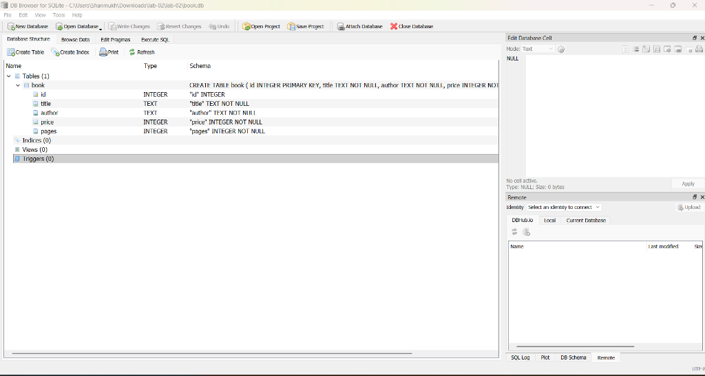
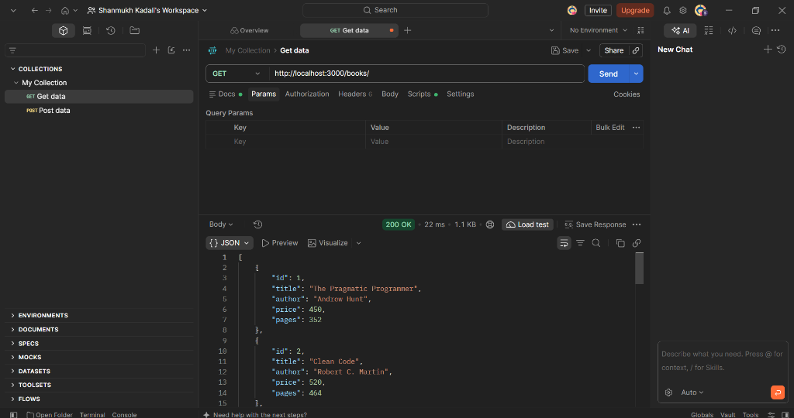
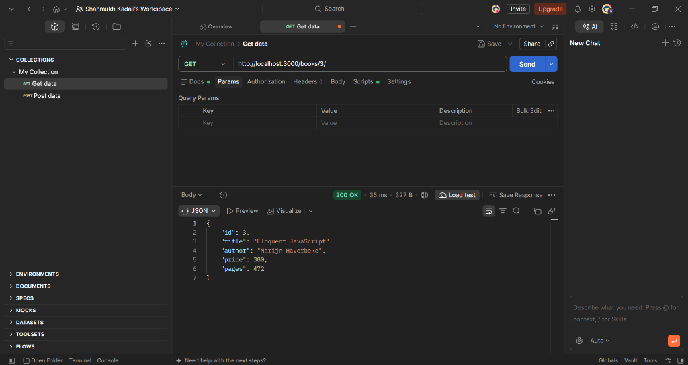
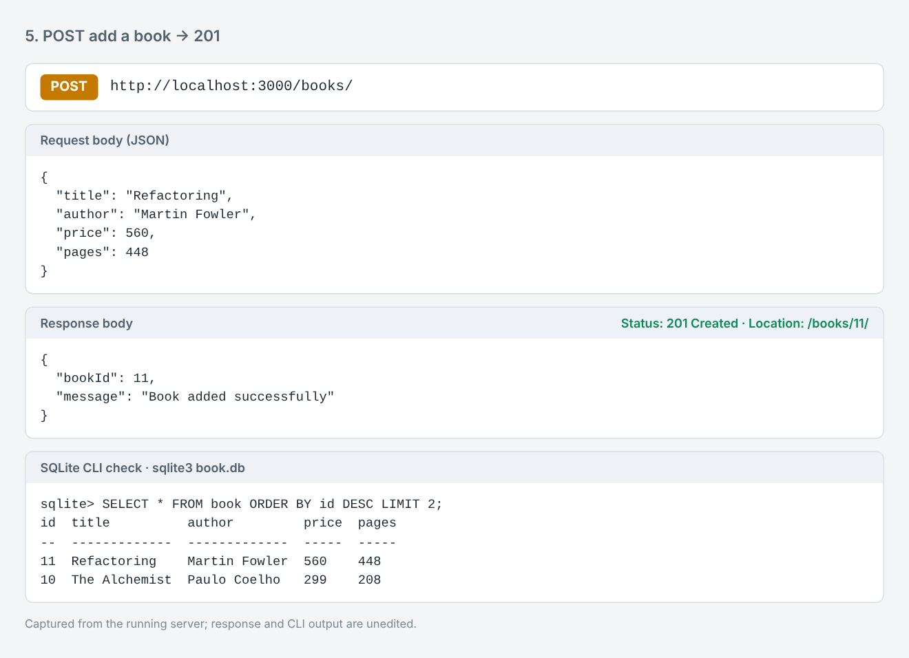
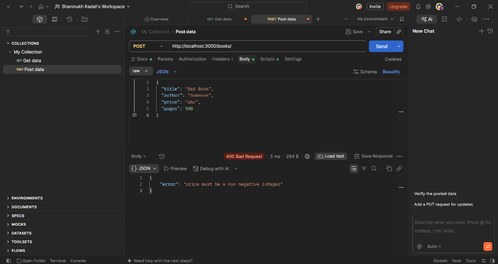
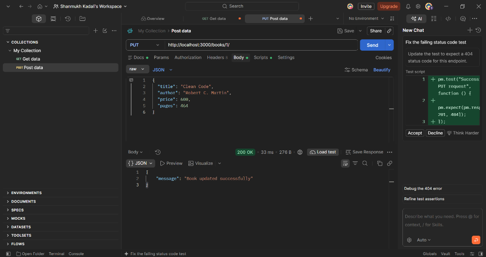
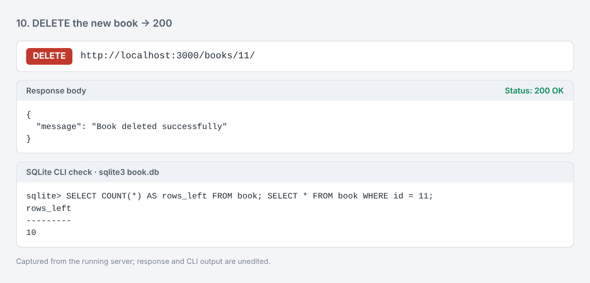
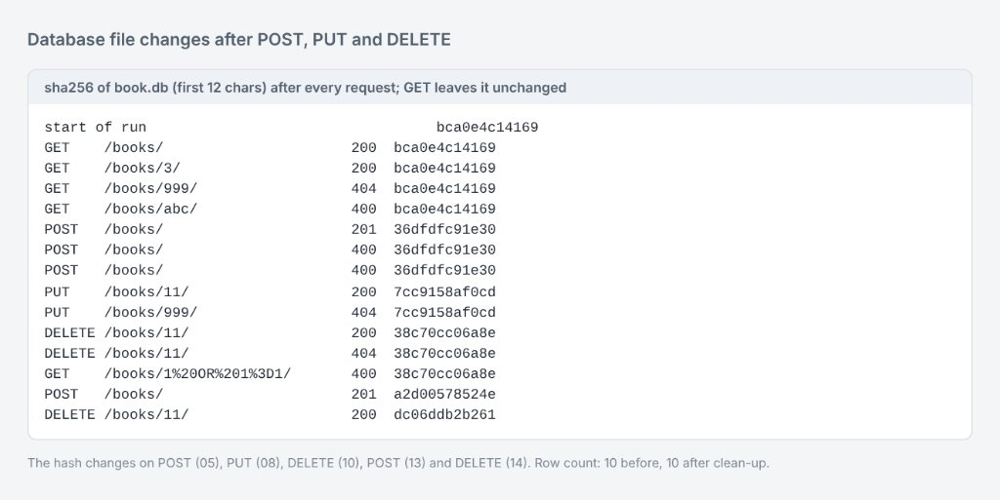
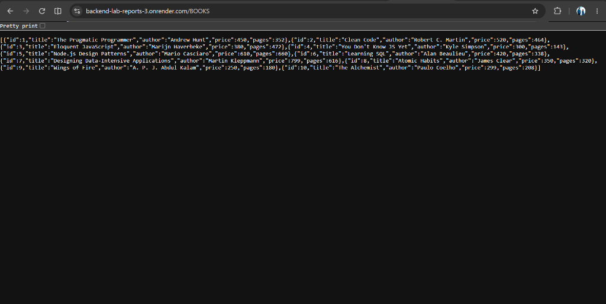

# Lab 2: SQLite database and CRUD routes

- **Name:** `<YOUR FULL NAME>`
- **Registration Number:** `<YOUR REG NO>`
- **Section:** `<YOUR SECTION>`
- **Course:** Backend Development Fundamentals
- **Lab Number:** 02

## Live Link

- **Deployment URL:** https://backend-lab-reports-3.onrender.com
- **Get All Books:** https://backend-lab-reports-3.onrender.com/books/
- **Get Single Book:** https://backend-lab-reports-3.onrender.com/books/1/

*(Hosted on Render's free tier. The first request after a period of inactivity can take up to a minute while the server wakes up.)*

## Objective

Connect an Express server to a SQLite database and expose CRUD operations (Create, Read, Update, Delete) over HTTP.

## Technologies Used

Node.js, Express.js, SQLite (`sqlite` + `sqlite3` packages), nodemon, Postman, Visual Studio Code

## Project Structure

```
lab-02/
├── screenshots/
├── index.js           # Express server + SQLite + all routes
├── book.db            # SQLite database file (table: book, 10 seed rows)
├── schema.sql         # SQL used to create the table and insert the rows
├── package.json
├── package-lock.json
├── .env.example
├── .gitignore
└── README.md
```

## How to Run

**Prerequisites:** Node.js 18 or newer and npm installed. (Optional: the SQLite CLI, to inspect `book.db`.)

```
cd lab-02
npm install
npm run dev      # development: nodemon restarts the server on every change
npm start        # plain start: node index.js
```

The server prints `Server running at http://localhost:3000/` once the database connection has succeeded.

**Environment variables:** both are optional; no secrets are used in this lab. Never commit a real `.env` file.

| Variable  | Default     | Purpose                          |
|-----------|-------------|----------------------------------|
| `PORT`    | `3000`      | Port the server listens on       |
| `DB_PATH` | `./book.db` | Path of the SQLite database file |

### Rebuild the database (optional)

`book.db` is already included with 10 seed rows. To rebuild it from scratch using the SQLite CLI:

```
sqlite3 book.db < schema.sql
```

To inspect the data:

```
sqlite3 book.db
.headers on
.mode column
SELECT * FROM book;
```

## Endpoints

| Method | Path              | Description                          | Success status | Error statuses |
|--------|-------------------|--------------------------------------|----------------|----------------|
| GET    | `/books/`         | Returns all books                    | 200 OK         | 500            |
| GET    | `/books/:bookId/` | Returns one book by id               | 200 OK         | 400, 404, 500  |
| POST   | `/books/`         | Adds a new book (JSON body)          | 201 Created    | 400, 500       |
| PUT    | `/books/:bookId/` | Updates all fields of a book         | 200 OK         | 400, 404, 500  |
| DELETE | `/books/:bookId/` | Deletes a book                       | 200 OK         | 400, 404, 500  |

**Request body for POST and PUT (all four fields are required):**

```json
{
  "title": "Clean Code",
  "author": "Robert C. Martin",
  "price": 520,
  "pages": 464
}
```

- `400 Bad Request`: invalid id, missing or invalid fields, or invalid JSON body.
- `404 Not Found`: no book with that id.
- `500 Internal Server Error`: unexpected database error.
- Every query that uses user input is parameterised with `?` placeholders.

## Screenshots

### Database structure (DB Browser for SQLite)



### GET all books



### GET one book



### POST add a book (201)



### POST with invalid fields (400)



### PUT update a book



### DELETE remove a book



### Database file changes after POST, PUT and DELETE



### Live deployment on Render



## Viva Questions

### 1. Why `await` the database call?

Every `db.get`, `db.all` and `db.run` call returns a Promise because disk I/O is asynchronous. Without `await`, the route would use the Promise object instead of the actual rows, or send the response before the query finishes, and errors would escape the `try/catch`.

### 2. What is SQL injection and how do placeholders prevent it?

SQL injection is when user input is concatenated into a SQL string so that the input is parsed as SQL — for example an id of `1 OR 1=1` returning every row, or a title containing `'); DROP TABLE book;--`. With `?` placeholders the SQL text is compiled first and the values are bound afterwards as data, so they can never change the structure of the query.

### 3. When is PUT used instead of POST?

POST creates a new resource and the server chooses its id (here: `POST /books/` returns a new `bookId`). PUT replaces an existing resource at a known URL (`PUT /books/1/`) and is idempotent: sending the same request twice leaves the same final state.

## Notes: Problems Faced and Solutions

- **`sqlite3` CLI was not installed by default**, so the table and seed rows could not be created from the command line. The `sqlite3` npm package is only the Node.js driver; it does not provide the CLI. DB Browser for SQLite was used to inspect the database instead.
- **Ids are reused after a delete.** With `INTEGER PRIMARY KEY` (no `AUTOINCREMENT`), SQLite assigns the next row `max(id) + 1`, so after deleting the last row the next POST gets the same id again. This is expected behaviour; `AUTOINCREMENT` would prevent reuse if that mattered.
- **A bad JSON body returned an HTML stack trace** by default. An error-handling middleware now catches `entity.parse.failed` and returns a clean `400` JSON response instead.
- **A wrong id should not look like an empty result.** `db.get` returns `undefined` for no match and `db.run` reports `changes === 0`; both are mapped to `404`.
- **Placeholders only protect values, not identifiers.** `?` cannot be used for table or column names, so none of those ever come from user input.
