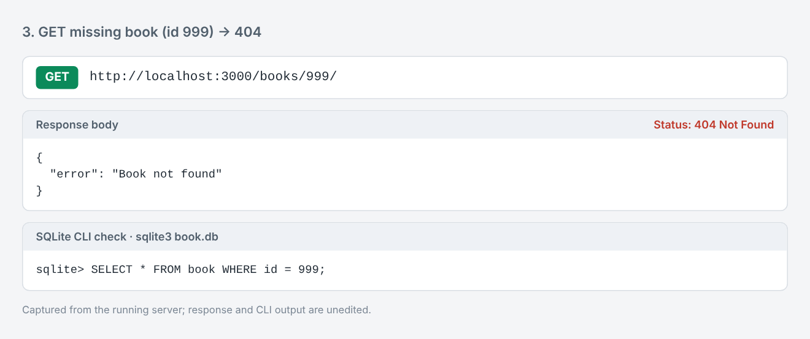
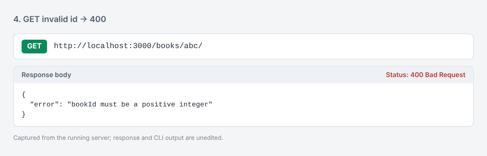
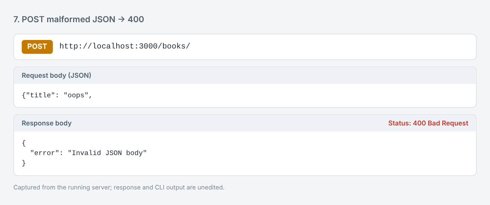
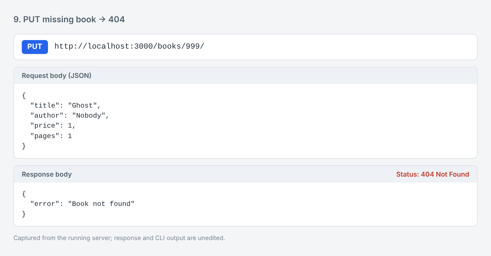
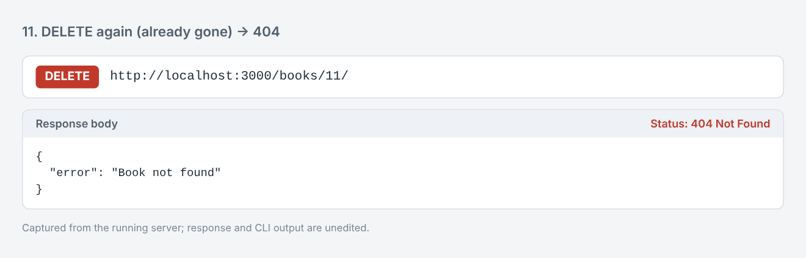
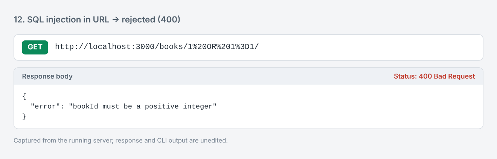
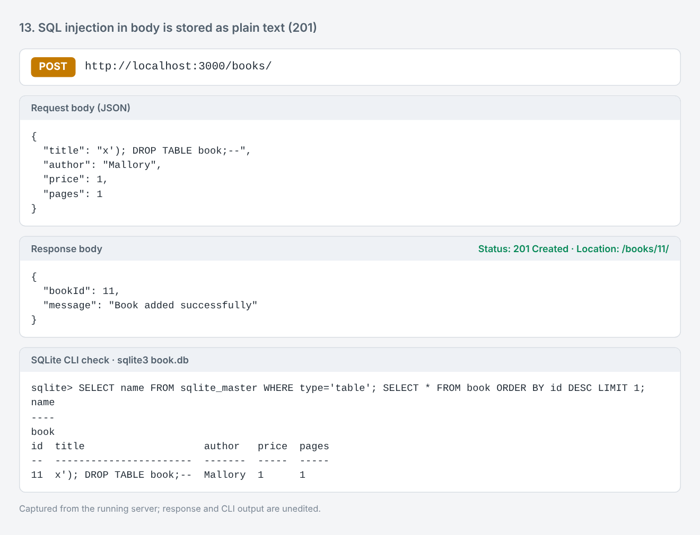
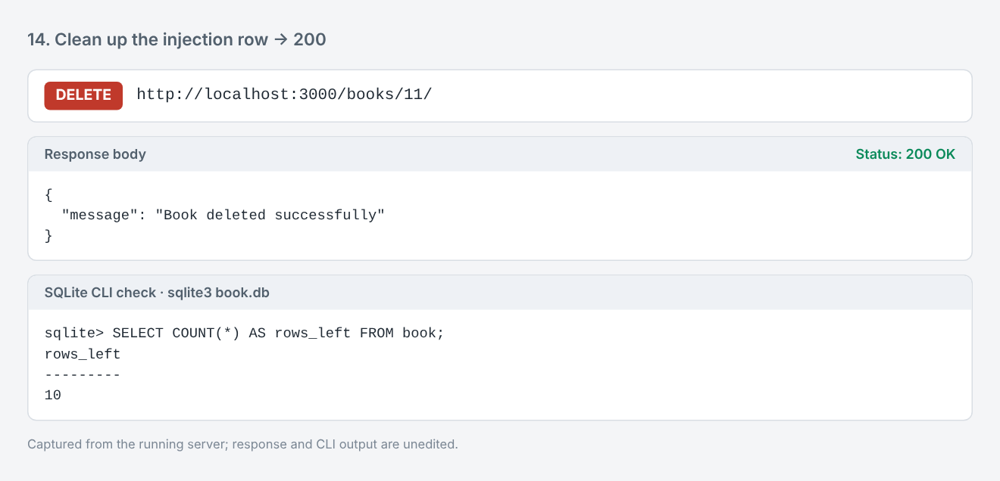
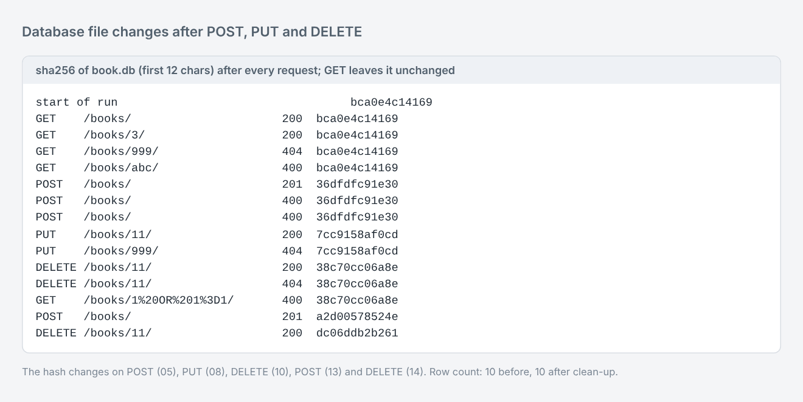

# Lab 2: SQLite database and CRUD routes

**Name:** `SHANMUKH NAGANJAN KADALI` · **Registration number:** `252U1R9050` · **Section:** `CSE-GEN-AI-2A-304`

**Live link:** Not deployed: link will be added soon

An Express server connected to a SQLite database (`book.db`) that exposes Create, Read, Update and Delete operations on a `book` table over HTTP.

## How to run

Requirements: Node.js 18 or newer. The SQLite CLI (`sqlite3`) is only needed if you want to rebuild or inspect the database by hand.

```bash
cd lab-02
npm install            # installs express, sqlite, sqlite3 and nodemon
npm run dev            # development: nodemon restarts the server on every change
# or
npm start              # plain node
```

The server prints `Server running at http://localhost:3000/` once the database connection has succeeded.

**Environment variables** (both optional, no secrets are used in this lab):

| Variable  | Default            | Purpose                                  |
|-----------|--------------------|------------------------------------------|
| `PORT`    | `3000`             | Port the server listens on               |
| `DB_PATH` | `./book.db`        | Path of the SQLite database file         |

**Rebuilding the database from scratch** (optional; `book.db` is already included):

```bash
rm book.db
sqlite3 book.db < schema.sql
sqlite3 book.db "INSERT INTO book (title, author, price, pages) VALUES ('Clean Code', 'Robert C. Martin', 520, 464);"
```

The committed `book.db` already holds 10 seed rows that were inserted from the SQLite CLI.

## Database

```sql
CREATE TABLE book (
  id     INTEGER PRIMARY KEY,
  title  TEXT NOT NULL,
  author TEXT NOT NULL,
  price  INTEGER NOT NULL,
  pages  INTEGER NOT NULL
);
```

## Endpoints

| Method | Path             | Description                                              | Success | Errors        |
|--------|------------------|----------------------------------------------------------|---------|---------------|
| GET    | `/books/`        | Return all books                                         | 200     | 500           |
| GET    | `/books/:bookId/`| Return one book by id                                    | 200     | 400, 404, 500 |
| POST   | `/books/`        | Add a book; returns the new `bookId` and a `Location`    | 201     | 400, 500      |
| PUT    | `/books/:bookId/`| Replace all fields of an existing book                   | 200     | 400, 404, 500 |
| DELETE | `/books/:bookId/`| Delete a book                                            | 200     | 400, 404, 500 |

Request body for POST and PUT (all four fields are required):

```json
{ "title": "Refactoring", "author": "Martin Fowler", "price": 560, "pages": 448 }
```

Status codes: `400` for an invalid id or body (including malformed JSON), `404` when no book has that id, `500` for unexpected database errors.

## Design notes

- `initializeDBAndServer()` opens the database first and calls `app.listen` only after the connection succeeds. If the connection fails it logs the error and exits, so the server never runs without a database.
- Every query that touches user input uses `?` placeholders; no SQL is ever built by joining strings.
- Route ids are also validated (`/^[1-9]\d*$/`) before they reach the database, and request bodies are type-checked.
- `UPDATE` and `DELETE` use `changes` from the driver to return `404` when nothing matched.

## Screenshots

Each screenshot shows the request, the response with its status code, and, where relevant, the matching `sqlite3` CLI output.

**1. GET all books**


**2. GET one book**


**3. GET a book that does not exist (404)**


**4. GET with an invalid id (400)**


**5. POST adds a book (201); CLI shows the new row**


**6. POST with invalid fields (400)**


**7. POST with malformed JSON (400)**


**8. PUT updates the book (200); CLI shows the changed row**


**9. PUT on a missing book (404)**


**10. DELETE removes the book (200); CLI shows it is gone**


**11. DELETE the same book again (404)**


**12. SQL injection attempt in the URL is rejected (400)**


**13. SQL injection attempt in the body is stored as harmless text; the table survives**


**14. Clean-up of the test row**


**15. The database file changes after POST, PUT and DELETE (and not after GET)**


## Notes: problems faced and how they were solved

- **`sqlite3` command was not installed**, so the table and seed rows could not be created from the CLI. Installing the `sqlite3` package (`apt install sqlite3`) fixed it. The `sqlite3` npm package is only the Node driver; it does not provide the CLI.
- **Ids are reused after a delete.** With `INTEGER PRIMARY KEY` (no `AUTOINCREMENT`), SQLite gives the next row `max(id) + 1`, so after deleting the last row the next POST gets the same id again. This is expected behaviour, not a bug; `AUTOINCREMENT` would prevent reuse if that mattered.
- **A bad JSON body returned an HTML stack trace** by default. An error-handling middleware now turns it into a `400` JSON response.
- **A wrong id should not look like an empty result.** `db.get` returns `undefined` for no match and `db.run` reports `changes === 0`; both are mapped to `404`.
- **Placeholders only protect values.** `?` cannot be used for table or column names, so none of those come from user input.

## Viva answers

**Why await the database call?** Every `db.get`, `db.all` and `db.run` call returns a Promise because disk I/O is asynchronous. Without `await`, the route would use the Promise object instead of the rows, or send the response before the query finishes, and errors would escape the `try/catch`.

**What is SQL injection and how do placeholders prevent it?** SQL injection is when user input is concatenated into a SQL string so that the input is parsed as SQL, for example an id of `1 OR 1=1` returning every row, or a title containing `'); DROP TABLE book;--`. With `?` placeholders the SQL text is compiled first and the values are bound afterwards as data, so they can never change the structure of the query. Screenshots 12 and 13 show this.

**When is PUT used instead of POST?** POST creates a new resource and the server chooses its id (here: `POST /books/` returns a new `bookId`). PUT replaces an existing resource at a known URL (`PUT /books/11/`) and is idempotent: sending the same request twice leaves the same final state.
